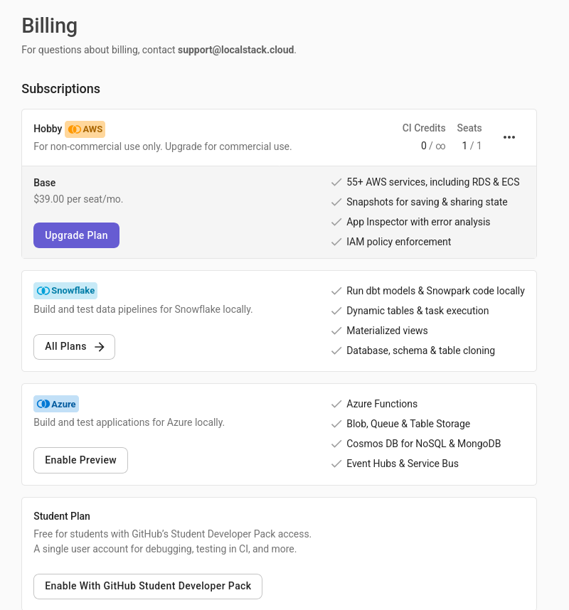
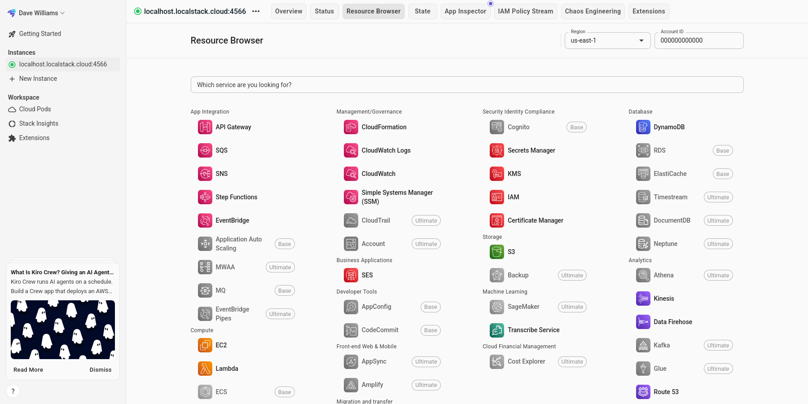
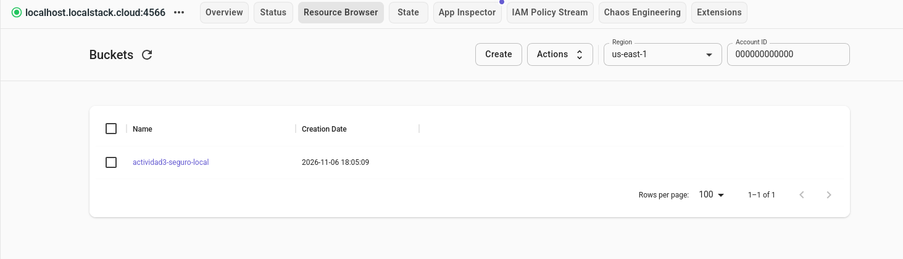

#+TITLE: Actividad 3
#+DATE: 06 11 2026
#+AUTHOR: Jahil Majorek Casas Sánchez
#+LANGUAGE: es
#+LATEX_CLASS: article
#+latex_class_options: [letterpaper]
#+latex_header: \input{~/Documents/Clases/sample.tex}
#+LATEX_HEADER: \renewcommand{\certificado}{CiberSeguridad}
#+LATEX_HEADER: \renewcommand{\matricula}{AL07083340}
#+LATEX_HEADER: \renewcommand{\docente}{Francisco Gómez Rubio}
#+ATTR_LATEX: :environment tabularx :width \textwidth :align X|X|X
#+OPTIONS: toc:t

* Resumen ejecutivo

Se construyó un bucket S3 simulado en LocalStack mediante Terraform, se declaró
cifrado SSE-S3 con AES-256 y se activaron los cuatro controles de bloqueo de
acceso público. Posteriormente se verificó la configuración con AWS CLI y se
probó una descarga anónima.

Resultado principal: la infraestructura declarada y la configuración consultada
coinciden (bucket, cifrado AES256 y cuatro controles en =true=), pero la prueba
anónima devolvió =HTTP 200=, lo que evidencia una limitación del simulador y no
una validación definitiva de la seguridad efectiva.

* Objetivo

Construir un bucket S3 simulado mediante Terraform, declarar cifrado AES-256 y
controles de bloqueo de acceso público, y verificar la configuración y el
comportamiento del servicio sin apuntar a AWS real.

* Entorno utilizado

| Elemento | Versión / valor |
|----------+-----------------|
| Sistema | Linux (Arch) |
| Docker CLI | Podman 6.1.4 (emulación de Docker) |
| Docker Compose | podman-compose 1.6.0 |
| Terraform | 1.15.9 |
| Provider AWS | 6.72.0 |
| AWS CLI | 2.39.5 |
| LocalStack | 2026.10.6 (licencia Hobby, edition =pro=) |
| Endpoint | =http://localhost:4566= |
| Región | =us-east-1= |
| Bucket | =actividad3-seguro-local= |

La imagen utilizada fue =localstack/localstack:latest= (1.16 GB). El contenedor
se publicó únicamente en =127.0.0.1:4566=.

* Archivos del proyecto

| Archivo | Función |
|---------+---------|
| =compose.yaml= | Contenedor LocalStack, solo S3, solo localhost |
| =providers.tf= | Provider AWS apuntando a LocalStack |
| =main.tf= | Bucket, cifrado AES256 y Public Access Block |
| =verificar.sh= | Consultas de comprobación con AWS CLI |
| =.env.example= | Plantilla del token (sin secreto) |
| =.env= | Token real, permisos =600=, excluido de Git |
| =.gitignore= | Excluye secretos, estado y datos locales |
| =README.md= | Documentación de reproducción |
| =evidencias/= | Salidas reales de los comandos |

* Proceso realizado

** 1. Registro y configuración del token

Se utilizó una cuenta LocalStack con plan *Hobby — Free*. El token se guardó
únicamente en el archivo local =.env=, con permisos =600= y excluido mediante
=.gitignore=:

#+begin_src bash
cp .env.example .env
chmod 600 .env
# Editar .env y definir:
# LOCALSTACK_AUTH_TOKEN=...
set -a
source .env
set +a
#+end_src

El token no se incluye en este reporte, en el repositorio ni en las capturas.

** 2. Levantar LocalStack

#+begin_src bash
docker compose up -d
docker compose ps
#+end_src

La imagen no incluye =curl=, por lo que el healthcheck original fallaba con
=/bin/sh: curl: not found=. Se corrigió usando el Python incluido en la imagen:

#+begin_src yaml
healthcheck:
  test: ["CMD-SHELL", "python3 -c \"import urllib.request; urllib.request.urlopen('http://localhost:4566/_localstack/health', timeout=3)\""]
  interval: 10s
  timeout: 5s
  retries: 12
  start_period: 20s
#+end_src

Estado final del contenedor:

#+begin_example
NAMES                  STATUS                   PORTS
actividad3-localstack  Up 25 seconds (healthy)  127.0.0.1:4566->4566/tcp
#+end_example

El endpoint de salud reportó:

#+begin_example
"services": { "s3": "running", ... },
"edition": "pro",
"version": "2026.10.6"
#+end_example

** 3. Inicializar y validar Terraform

#+begin_src bash
terraform init
terraform validate
terraform plan
#+end_src

Resultado de la validación:

#+begin_example
Success! The configuration is valid.
#+end_example

Resultado del plan:

#+begin_example
Plan: 3 to add, 0 to change, 0 to destroy.
#+end_example

Los tres recursos son:

- =aws_s3_bucket.seguro=
- =aws_s3_bucket_server_side_encryption_configuration.seguro=
- =aws_s3_bucket_public_access_block.seguro=

** 4. Aplicar la infraestructura

#+begin_src bash
terraform apply
#+end_src

Resultado:

#+begin_example
aws_s3_bucket.seguro: Creation complete after 0s [id=actividad3-seguro-local]
aws_s3_bucket_public_access_block.seguro: Creation complete after 0s [id=actividad3-seguro-local]
aws_s3_bucket_server_side_encryption_configuration.seguro: Creation complete after 0s [id=actividad3-seguro-local]

Apply complete! Resources: 3 added, 0 changed, 0 destroyed.
#+end_example

Estado de Terraform:

#+begin_example
aws_s3_bucket.seguro
aws_s3_bucket_public_access_block.seguro
aws_s3_bucket_server_side_encryption_configuration.seguro
#+end_example

** 5. Verificación con AWS CLI

Se usaron credenciales ficticias y el endpoint local:

#+begin_src bash
export AWS_ACCESS_KEY_ID=test
export AWS_SECRET_ACCESS_KEY=test
export AWS_DEFAULT_REGION=us-east-1
EP=http://localhost:4566

aws --endpoint-url $EP s3api list-buckets
aws --endpoint-url $EP s3api get-bucket-encryption --bucket actividad3-seguro-local
aws --endpoint-url $EP s3api get-public-access-block --bucket actividad3-seguro-local
aws --endpoint-url $EP s3api get-bucket-policy --bucket actividad3-seguro-local
#+end_src

Listado de buckets:

#+begin_example
{
  "Buckets": [
    {
      "Name": "actividad3-seguro-local",
      "CreationDate": "2026-11-06T18:05:09+00:00",
      "BucketRegion": "us-east-1",
      "BucketArn": "arn:aws:s3:::actividad3-seguro-local"
    }
  ]
}
#+end_example

Cifrado:

#+begin_example
{
  "ServerSideEncryptionConfiguration": {
    "Rules": [
      {
        "ApplyServerSideEncryptionByDefault": {
          "SSEAlgorithm": "AES256"
        },
        "BucketKeyEnabled": false
      }
    ]
  }
}
#+end_example

Bloqueo de acceso público:

#+begin_example
{
  "PublicAccessBlockConfiguration": {
    "BlockPublicAcls": true,
    "IgnorePublicAcls": true,
    "BlockPublicPolicy": true,
    "RestrictPublicBuckets": true
  }
}
#+end_example

Política del bucket:

#+begin_example
An error occurred (NoSuchBucketPolicy) when calling the GetBucketPolicy operation:
The bucket policy does not exist
#+end_example

=NoSuchBucketPolicy= solo indica que no hay una política adjunta; no confirma
por sí solo que el bucket sea privado ni público.

** 6. Carga del archivo de prueba

#+begin_src bash
printf 'Archivo de prueba - Actividad 3\n' > test.txt
aws --endpoint-url $EP s3 cp test.txt s3://actividad3-seguro-local/
aws --endpoint-url $EP s3 ls s3://actividad3-seguro-local/
#+end_src

Resultado:

#+begin_example
upload: ./test.txt to s3://actividad3-seguro-local/test.txt
2026-11-06 12:05:22         32 test.txt
#+end_example

Verificación del objeto:

#+begin_example
{
  "ContentLength": 32,
  "ContentType": "text/plain",
  "ServerSideEncryption": "AES256",
  "ETag": "\"544936653690316e6085ec60f2dfbb13\""
}
#+end_example

** 7. Prueba de acceso anónimo

Se intentó descargar el objeto sin firmar la solicitud:

#+begin_src bash
curl -i http://localhost:4566/actividad3-seguro-local/test.txt
#+end_src

Resultado real:

#+begin_example
HTTP/1.1 200 OK
Content-Type: text/plain
Content-Length: 32
x-amz-server-side-encryption: AES256
x-localstack: 2026.10.6

Archivo de prueba - Actividad 3
#+end_example

El acceso anónimo fue *permitido* (=200 OK=). Esto no demuestra que el bucket
fuera público en AWS real: LocalStack es un emulador y, por defecto, no aplica
todas las reglas de autorización de AWS (firmas, políticas y ACL) con el mismo
rigor. La configuración de bloqueo se almacena y se reporta correctamente, pero
su aplicación efectiva sobre solicitudes anónimas es limitada.

En AWS real, con los cuatro controles activos y sin política pública, se
esperaría un =403 AccessDenied= para esa misma solicitud. Esa comprobación
requeriría una validación independiente contra AWS o una versión del emulador
con enforcement de autenticación.

** 8. Dashboard y capturas de evidencia

Se inició sesión en el dashboard de LocalStack con la cuenta Hobby y se abrió el
explorador de recursos S3 apuntando a =http://localhost:4566=. Se verificó la
existencia del bucket =actividad3-seguro-local=, su contenido y su configuración
de seguridad.

#+CAPTION: Plan Hobby — Free seleccionado en LocalStack.
#+NAME: fig:hobby
#+ATTR_LATEX: :width 0.55\textwidth
#+ATTR_HTML: :width 55%

#+CAPTION: Dashboard de LocalStack con el bucket creado.
#+NAME: fig:dashboard
#+ATTR_LATEX: :width 0.95\textwidth
#+ATTR_HTML: :width 95%

#+CAPTION: Explorador S3 con el bucket y los objetos del laboratorio.
#+NAME: fig:bucket
#+ATTR_LATEX: :width 0.95\textwidth
#+ATTR_HTML: :width 95%

* Resultados obtenidos

| Comprobación | Resultado |
|--------------+-----------|
| Bucket creado | =actividad3-seguro-local= |
| Recursos Terraform | 3 creados |
| Cifrado por defecto | =AES256= |
| =BlockPublicAcls= | =true= |
| =IgnorePublicAcls= | =true= |
| =BlockPublicPolicy= | =true= |
| =RestrictPublicBuckets= | =true= |
| Política del bucket | =NoSuchBucketPolicy= |
| Objeto de prueba | =test.txt=, 32 bytes, cifrado AES256 |
| Acceso anónimo | =HTTP 200= (limitación del simulador) |

* Infraestructura declarada, configuración consultada y seguridad aplicada

** Infraestructura declarada

Terraform declara tres recursos: el bucket, la configuración de cifrado
SSE-S3/AES256 y el bloqueo de acceso público con sus cuatro controles. El plan
confirmó exactamente tres recursos a crear y el apply los creó sin errores.

** Configuración consultada

AWS CLI confirma que el bucket existe, que el cifrado reportado es =AES256= y
que los cuatro controles están en =true=. También confirma que no hay política
de bucket adjunta (=NoSuchBucketPolicy=). Hay coincidencia entre lo declarado y
lo consultado.

** Seguridad efectivamente aplicada

La prueba anónima devolvió =200 OK=, por lo que no se puede afirmar que la
seguridad se aplique igual que en AWS. LocalStack reproduce la API y almacena la
configuración, pero no necesariamente todas las decisiones de autorización. La
conclusión correcta es: *la configuración está declarada y es consultable, pero
la eficacia real del bloqueo no queda demostrada por esta prueba*.

* Evidencias generadas

| Archivo | Contenido |
|---------+-----------|
| =evidencias/01-versiones.txt= | Versiones de Podman, Compose, Terraform, AWS CLI e imagen |
| =evidencias/02-terraform-validate.txt= | Resultado de =terraform validate= |
| =evidencias/03-terraform-plan.txt= | Plan con 3 recursos |
| =evidencias/04-terraform-apply.txt= | Aplicación con 3 recursos creados |
| =evidencias/05-awscli-verificacion.txt= | Buckets, cifrado, controles y política |
| =evidencias/06-carga-objeto.txt= | Subida y listado de =test.txt= |
| =evidencias/07-acceso-anonimo.txt= | Respuesta HTTP del acceso anónimo |
| =evidencias/08-estado-recursos.txt= | Estado de Terraform y metadatos del objeto |
| =evidencias/09-plan-sin-cambios.txt= | Verificación de idempotencia (0 cambios) |
| =evidencias/hobby-plan.png= | Captura del plan Hobby seleccionado |
| =evidencias/DashBoard.png= | Captura del dashboard de LocalStack |
| =evidencias/bucket-localstack.png= | Captura del bucket en el explorador S3 |

Todas las evidencias solicitadas quedan cubiertas:

- Plan Hobby: incluido en =hobby-plan.png=.
- Dashboard de LocalStack: incluido en =DashBoard.png=.
- Bucket en el explorador S3: incluido en =bucket-localstack.png=.
- Salidas de Terraform y AWS CLI: incluidas en =evidencias/01= a =09=.

* Conclusiones

1. Terraform permitió declarar el bucket, el cifrado y los controles de forma
   reproducible.
2. La configuración declarada coincide con la configuración consultada mediante
   AWS CLI.
3. El acceso anónimo permitido por LocalStack demuestra una limitación del
   simulador; no debe interpretarse como una exposición real del bucket.
4. La seguridad efectivamente aplicada no puede certificarse solo con LocalStack:
   requiere una validación independiente o una prueba contra AWS real.
5. Un segundo =terraform plan= posterior al apply devolvió código 0 y el mensaje
   =No changes=, confirmando que la infraestructura coincide con la configuración
   declarada (idempotencia).

* Recomendaciones de seguridad

- Rotar el token de LocalStack, ya que fue compartido fuera del archivo local.
- Mantener =.env= con permisos =600= y fuera de Git.
- No subir =*.tfstate=, =.terraform/= ni capturas con tokens.
- Usar credenciales ficticias y el endpoint local en todos los comandos.
- Si se reutiliza el laboratorio, revisar que el contenedor escuche solo en
  =127.0.0.1=.
